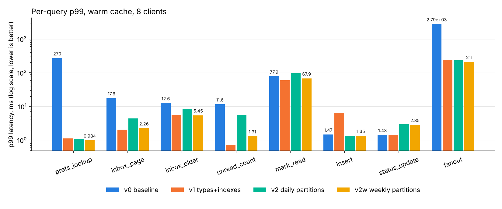
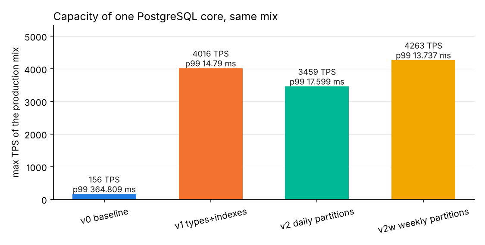

# SIS #3 — Database tuning: Notification Service

Builds on SIS #1 (design) and SIS #2 (gRPC). Here the PostgreSQL part is tuned **and measured**: schema + indexes, `EXPLAIN ANALYZE`, partitioning, connection pooling, read replica. Everything is reproducible from this repo (`README.md`); every number below comes from `results/` via `bench/make_tables.py` (full tables: `results/TABLES.md`).

## 1. Problem and test setup

**Why this matters.** In SIS #1 PostgreSQL holds prefs/devices/templates/campaigns and takes **3 000 QPS if Redis is down** (150 QPS with 95 % cache hit). In SIS #1 I also wrote "alt: PG partitioned by day". This SIS tests that alternative quantitatively: the inbox + delivery status lives in a PG table too (so the PG-only variant of the design is measured; Cassandra stays the SIS #1 production choice, see §8).

**Model = 1:100 of SIS #1 numbers.** 200 k users, 400 k devices, **25.06 M notifications** (10 / s = 864 k / day = 86 M/day ÷ 100, 29 days), ≈125 rows per user as in SIS #1 (86 M × 30 d / 20 M users). Row ≈150 B instead of 500 B (disk limits) — see §9.

**Workload** (ratios from SIS #1 peak: 3 000 prefs, 3 000 insert, 3 000 status-update, ≈700 inbox reads per second), 8 queries, weights per 1 073 transactions:
`prefs_lookup 300 · inbox_page 70 · inbox_older (keyset) 25 · unread_count 70 · mark_read 7 · insert 300 · status_update 300 · fanout 1`.

**Method.** `pgbench` custom scripts, prepared statements, per-transaction log → p50/p95/p99. Open-loop runs (`-R`) report *response* latency = service time + queueing (what a caller sees). Same `postgresql.conf` for every run (`infra/`), `synchronous_commit=on`, so the only variable is what is under test. Warm-up before each run; a *cold* mode (restart + `drop_caches`) is used because production data (2.6 B rows) never fits in RAM, while this 5 GB dataset does.

## 2. Schema and indexes — designed from the query list

| query | access pattern | index / design | why |
|---|---|---|---|
| prefs by user | PK point read | `user_preferences(user_id)` PK | already optimal: 7 buffers, 0.05 ms |
| push tokens by user | equality on `user_id` | `devices (user_id) INCLUDE (platform, token)` | index-only scan, no heap visit |
| inbox page / keyset next page | `user_id = ?` + order by `created_at DESC` + `LIMIT 20` | `notifications (user_id, created_at DESC, id DESC)` | rows come out already sorted; the scan stops after 20 |
| unread badge, mark-all-read | `user_id = ? AND NOT is_read` (≈15 % of rows) | partial index `(user_id) WHERE NOT is_read` | 28 MB instead of 969 MB |
| status webhook | `id` + known creation second | PK `(id, created_at)`, predicate on `created_at` → prunes to 1 partition | provider callback carries a time-ordered id |
| campaign fan-out | keyset scan over users joined with devices | same covering index on `devices` | nested loop instead of scanning 400 k devices per batch |

Types: `smallint` enums for channel/status, 8-byte columns first. **Honest result:** these + `fillfactor 90` made the table 5 % *bigger* (3 810 → 4 015 MB; fillfactor costs more than enums save) and HOT-update share only moved 98 % → 100 % with unchanged latency (§7). They are not a performance lever here.

## 3. EXPLAIN ANALYZE evidence (warm; `explain/*.txt`)

| query | v0 baseline | v1 (types + indexes) | what changed in the plan |
|---|---|---|---|
| devices by user | 23.8 ms, **6 350 buffers** | 0.085 ms, 7 buffers | Parallel Seq Scan over 400 k rows → Index Only Scan |
| inbox page | 0.29 ms, 125 buffers | 0.17 ms, 27 buffers | index on `user_id` fetched all ≈113 rows + top-N sort → ordered index scan, 20 rows |
| unread count | 0.26 ms, 119 buffers | 0.13 ms, 14 buffers | filter over all user rows → partial index |
| fan-out batch (1 000) | 152.7 ms, 7 859 buffers | 27.9 ms, 2 698 buffers | Hash Join + Seq Scan of devices → Nested Loop + covering index |

Warm, the inbox gain looks small (everything is in RAM). The buffer count is the real gain: it is the number of random page reads when the cache is cold — measured next.

## 4. Results — before / after (p95 / p99, ms)

| query (p99 ms) | v0 | v1 | v2w (final) | cold cache v0 → v2w |
|---|---|---|---|---|
| prefs_lookup | 270 | 1.1 | 0.98 | 270 → 0.96 |
| inbox_page | 17.6 | 2.1 | 2.3 | 57 → 9.8 |
| inbox_older | 12.6 | 5.5 | 5.4 | 33 → 9.7 |
| unread_count | 11.6 | 0.72 | 1.3 | 29 → 4.9 |
| insert | 1.5 | **6.4** | 1.35 | – |
| status_update | 1.4 | 1.4 | 2.8 | – |
| fan-out batch | 2 791 | 237 | 211 | – |
| mark_read | 78 | 59 | 68 | see §6 |

Whole production mix on **one PostgreSQL core**:

| version | @100 TPS p95 / p99 | max TPS | @2 000 TPS p95 / p99 |
|---|---|---|---|
| v0 baseline | 219 / 311 ms | 156 | cannot sustain |
| v1 types + indexes | 1.9 / 3.7 ms | 4 016 | 4.2 / 17 ms |
| v2 daily partitions | 2.9 / 7.0 ms | 3 459 | **580 / 876 ms** |
| **v2w weekly partitions** | 1.9 / 4.2 ms | **4 263 (27×)** | 3.8 / 38 ms |

**Why each gain happens**
1. *Covering index on `devices(user_id)`* — the single biggest win (p99 270 → 1 ms, 240×). The first draft forgot it; the "Redis down" path (3 000 QPS) × 24 ms = 72 cores of pure scanning. With it: 7 buffers.
2. *Composite inbox index* — the old plan read every row of the user (≈113 random heap pages) to return 20. The new index delivers rows in sort order and stops: 27 buffers. Cold: p99 57 → 10.6 ms.
3. *Partial unread index* — only 15 % of rows are unread, so the index is 35× smaller than the inbox index and the count touches 14 buffers.
4. *Covering index for fan-out* — turns a seq scan of devices on every batch into index lookups (p99 ÷12).

## 5. Partitioning — a trade, not a free win

`PARTITION BY RANGE (created_at)`, PK `(id, created_at)`, local indexes.

| | v1 single table | v2 daily | v2w weekly |
|---|---|---|---|
| insert p99 / max TPS | 6.4 ms / 2 629 | 1.3 ms / 14 148 | 1.35 ms / 12 375 |
| WAL per INSERT | **3.6 KB** | 0.49 KB | 0.53 KB |
| inbox_page / unread_count p99 | 2.1 / 0.7 ms | 4.4 / 5.5 ms | 2.3 / 1.3 ms |
| status_update p99 / TPS | 1.4 ms / 14 248 | 3.0 ms / 6 844 | 2.8 ms / 7 181 |

- **Writes.** v1 added a 969 MB index that every insert hits at a random place → p99 ×4.3 and WAL ×8 vs the v0 baseline. Per-partition indexes are small and the current one stays in cache: insert returns to baseline speed (**4.7× faster than v1**).
- **Retention** (delete 1 day = 864 k rows): `DELETE` 6.2 s + 97 MB WAL + 1.0 M dead tuples + 78 s VACUUM, and the file does not shrink; `DROP PARTITION` 0.115 s, 0.09 MB WAL. At full scale the DELETE is 100× larger and competes with live traffic.
- **Cost on reads.** A query by `user_id` without a time bound must probe *every* partition: daily = 30 index descents per lookup. At 2 000 TPS the daily layout collapsed (p99 876 ms; reproduced twice) while backends were seen waiting on `IO:DataFileRead` and `IO:WALSync`. My explanation (consistent with, not proven by, the wait events): the page footprint per lookup ×30 no longer fits the cache and disk reads queue behind fsync on the same device. Weekly (5 partitions) removes the effect (38 ms). Cost of weekly: retention granularity is a week (30–37 days stored).
- **When partitioning is a bad choice:** low write rate, no time-based retention, or queries that can't be bounded by the partition key.
- `status_update` is 2× slower in both layouts (partition pruning/lock overhead per statement) — accepted for webhooks (p99 2.8 ms).

## 6. Read state: `is_read` per row vs. watermark (found while measuring)

`mark_read` was the worst remaining query in every version (p99 59–95 ms, ≤250 TPS): updating ~19 rows changes `is_read` which is in a partial-index predicate, so no HOT update — heap + 2 index pages changed per row, ≈5.8 KB WAL per row. Alternative: one row `user_read_state(user_id, last_read_at)`; unread = `created_at > last_read_at`.

| (daily partitions, warm) | p99 | TPS |
|---|---|---|
| mark_read, per-row | 95.5 ms | 151 |
| mark_read, watermark upsert | **1.1 ms** | 13 183 |
| unread_count, partial index → watermark | 5.5 → 4.6 ms | 4 218 → 5 904 |

Cost: no per-notification "read" flag (marking a *single* item read needs a small exception set).

## 7. Connection pooling (PgBouncer, transaction mode, pool 8)

| 400 app connections, v2w | direct | via PgBouncer |
|---|---|---|
| closed loop: TPS / p99 | 2 652 / 1 160 ms | **4 485 / 204 ms** |
| 2 000 TPS open loop: p95 / p99 | 1 925 / 2 528 ms (**not sustained**) | **2.7 / 8.7 ms** |
| new connection per transaction: TPS | 211 | **3 907 (18×)** |

Why: one core can execute only 1–2 queries at a time; 400 backends just add context switches, lock/WAL-write queues and per-backend memory. Pooling keeps ≈8 active backends and queues the rest cheaply. With a new connection per transaction (211 TPS ≈ 4.7 ms per transaction vs ≈0.25 ms of real work) connect/fork/auth dominates. Trade-offs: transaction mode forbids session state (`SET`, advisory locks, `LISTEN`); prepared statements need `max_prepared_statements` (PgBouncer ≥ 1.21); the pooler is one more hop (+0.1 ms) and a component to run in HA. Rule of thumb: pool ≈ 2–4 × cores, *not* = number of app threads.

## 8. Read replica and what it means for SIS #1

Same total load 3 500 TPS (1 520 reads + 1 980 writes), primary pinned to 1 core:

| | read p95 / p99 | write p95 / p99 |
|---|---|---|
| everything on primary | 9.9 / 65 ms | 840 / **1 007 ms** (not sustained) |
| reads → async replica | 5.1 / 19.5 ms | 11 / **36.7 ms** |

Moving reads off the primary protects the *write* tail (27×). Replication: replay lag during the run max 124 ms, ≤187 KB behind; idle commit→visible gap p99 0.96 ms. Rules: reads that need read-your-writes (just marked read → refresh badge) go to the primary or are sticky for ~2 s; `hot_standby_feedback` can bloat the primary; async replica = up to the lag is lost on failover (SIS #1 already accepts 30–60 s Patroni failover).

**Capacity vs SIS #1.** One core did 4.26 k TPS of this mix; the SIS #1 peak mix is ≈10.5 k TPS → ≥2.5 cores of pure DB CPU, ≈4–5 at 60 % utilisation, plus I/O at 100× the data. Inbox at full scale ≈ 0.4 TB table + 0.15 TB indexes (×100 of v1 sizes) — one node is possible but leaves no headroom; growth needs sharding by `user_id`. That supports the SIS #1 choice: **PostgreSQL for prefs/devices/templates (≈20 GB, tuned as above), Cassandra for the inbox/status**; the PG-inbox variant is viable for ~10× smaller systems.

## 9. Limits of this evidence (read before the defense)

- Sandbox has **2 vCPU / 8 GB**: absolute TPS are small; use ratios. Primary = core 0; load generator, PgBouncer and replica share core 1 (replica results are therefore *pessimistic* for the replica path).
- **Single run per cell, no repeats**: treat differences under ~20 % as noise.
- 5 GB of data fits in RAM; the cold mode partly corrects this. Users are uniform (real traffic is skewed → better cache hit).
- Row 150 B vs 500 B; inbox reads are 950/s-equivalent in the mix (SIS #1: 700) — conservative for reads.
- Not covered: autovacuum tuning, `pg_stat_statements` workflow, Patroni failover, multi-AZ.
